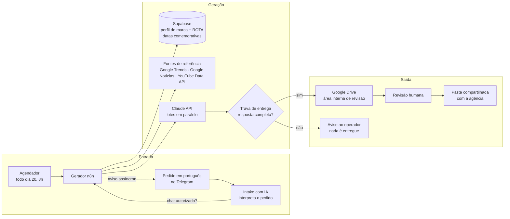

# Arquitetura

## Visão geral

## Stack

| Camada | Tecnologia | Por quê |
|---|---|---|
| Orquestração | **n8n** self-hosted (VM na Oracle Cloud, atrás do Cloudflare) | Fluxos visuais que a agência consegue entender; custo fixo baixo |
| Texto | **Claude API** (Sonnet), chamada por nó HTTP | Qualidade em português e saída JSON confiável |
| Dados | **Supabase** (PostgreSQL + RLS) | Multi-cliente com perfil de marca em `jsonb`; painel lê direto com sessão autenticada |
| Interface da agência | **Bot do Telegram** | A agência pede em linguagem natural, sem acessar nenhuma ferramenta |
| Entrega | **Google Drive / Docs** | É onde a agência já trabalha; comenta direto no Doc |
| Relatórios | **Conector MCP** no n8n + Claude no claude.ai | O modelo pede os números a uma ferramenta; os cálculos são feitos por código |
| Referências | Google Trends, Google Notícias, **YouTube Data API** (cota gratuita de 10 mil unidades/dia) | Assuntos e vídeos em alta, sempre com o link da fonte |

## Fluxos do n8n

| Fluxo | Gatilho | O que faz |
|---|---|---|
| **Gerador do mês** | Agendador (dia 20) + webhook protegido por token | Lê o perfil do cliente, monta a pauta, chama o Claude e grava o resultado no Drive e no Supabase |
| **Intake por Telegram** | Mensagem recebida no bot | Um nó de IA extrai os parâmetros do pedido ("gera janeiro com foco em prevenção") e chama o gerador |
| **Pastas do mês** | Dia 20 e toda segunda | Atualiza as pastas de Datas comemorativas e Referências |
| **Sugestão de imagens** | Webhook | Sugere fotos reais da pasta de material bruto do cliente |
| **Conector MCP: `relatorio_de_metricas`** | Chamada de ferramenta pelo Claude | Recebe o CSV exportado do Meta Business Suite e devolve os números do relatório ([código](../src/relatorio-de-metricas.js)) |
| **Lembrete do relatório** | Todo dia útil às 9h | Só envia no antepenúltimo dia útil do mês, com feriados nacionais e locais ([código](../src/dias-uteis.js)) |

## Decisões técnicas que valem destacar

**1. Resposta assíncrona por causa do Cloudflare.**
Um mês completo levava cerca de 3 minutos para gerar, mas o Cloudflare corta respostas HTTP depois de mais ou menos 100 segundos. Esse bug apareceu ao vivo, na call de apresentação com a agência. A solução foi o bot confirmar o pedido na hora e mandar uma segunda mensagem quando a geração termina.

**2. Lotes paralelos contra o limite de tokens.**
Quando as datas especiais entraram na geração, o mês passou de 5 para 23 peças e a resposta estourava o limite de saída. A geração passou a sair em lotes de 8 peças em paralelo, com validação por slot.

**3. Trava antes de entregar.**
Em 20/10 a geração automática saiu vazia: o modelo gastou o teto de tokens raciocinando e Docs vazios chegaram à pasta do cliente. Desde então nada é escrito na pasta compartilhada sem passar pela [trava de entrega](../src/trava-de-entrega.js).

**4. Números só por script.**
O modelo de linguagem escreve a leitura do relatório, mas não calcula nenhum número. Os cálculos ficam numa ferramenta determinística, e o prompt da ferramenta proíbe estimar.

**5. Hierarquia de regras de marca.**
O "jeito de ser" da agência (ROTA) fica **acima** do perfil de cada cliente: o perfil ajusta o tom, mas nunca contraria a filosofia da agência. Toda restrição dita pelo cliente vira regra no perfil. Exemplos: médicos não aparecem em vídeo; nada de preço, convênio ou promessa de resultado.

**6. Segurança.**
Os webhooks são protegidos por token no header. O bot só atende chats autorizados (liberados com `/liberar`). As chaves ficam no cofre de credenciais do n8n. A agência tem acesso de **comentador** (nunca de editor) à pasta compartilhada.

## Infraestrutura compartilhada

O n8n e o Supabase são divididos com outro produto do mesmo autor. Por isso as tabelas usam o prefixo `mdc_`, e toda mudança passa pela análise de impacto da Linha da Máquina ([prompt](../prompts/analise-de-impacto.md)), que considera efeitos indiretos sobre o outro produto.
